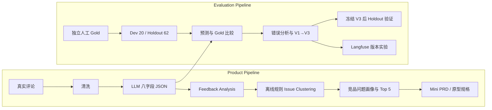

# AI 用户反馈与产品需求分析工作台

AI User Feedback & Product Insight Workbench

> 本仓库为作品集公开脱敏副本：已清除原始评论表与 Gold Set 的用户名，保留评论 ID、评论原文、标签和历史实验结果。数据处理范围与哈希说明见 [公开数据说明](docs/publication_notes.md)。默认可离线浏览，无需 API Key；GitHub 仓库提供源代码，尚未部署在线服务。

## Project Overview

面向产品经理与运营的本地 MVP：将分散评论转成可追溯的问题洞察与需求建议，并用人工 Gold 检查 AI 分析是否可信。连接「反馈 → 结构化分析 → 质量验证 → Issue → 产品需求」，不是仅生成摘要。项目未正式线上部署。

## Product Workflow



Gold 是已有人工标注，不是模型预测生成。图示为已有流程，启动页面不会重跑实验。

## Final Workbench

| 页面 | 核心内容 |
| --- | --- |
| Overview | 样本规模、关键产品发现、Top Issues、AI Quality Snapshot |
| Feedback Analysis | 原始评论与 AI 标签；Feedback → Issue → 全部原始 Evidence 双向追溯 |
| Evaluation Lab | 历史 Dev V1/V2/V3、Holdout、错误样本、已保存的 Langfuse 实验 |
| Product Insights | 飞书/Lark vs 企业微信模块画像、Top 5、方案建议与未来验证指标 |

默认只读本地成果；可选 Mock 联调与历史真实结果隔离，不参与质量成绩。

Feedback Analysis 顶部支持 **Import → Analyze → Review → Update Insights**：上传 CSV/XLSX/XLS，选择工作表与列、检查空值和重复，再主动点击 Analyze Feedback。当前入口仅 Demo / Mock，不请求真实模型。查看结果、选择排除 ID 并确认后，点击 Update Issue & Product Insights 才复用 E1/E2。

新批次独立保存于 `analysis/results/user_runs/<batch_id>/`：结构化 CSV/JSON、批次元数据，以及独立更新目录中的 E1/E2 成果。Product Insights 的 Analysis Run 可切换 Original E2 与已完成批次，支持 Issue → 全部原文回溯。结构化失败保留成功行且阻止洞察；洞察失败保留结构化结果，可手动再试。新候选不等于人工确认的产品事实，首页和历史评价不随上传改变。

## Dataset & Evaluation

模型：`gpt-6.1-sol`。82 条人工 Gold：Dev 为 L001–L020（20 条）；Holdout 为 L021–L043 + W001–W039（62 条），在 V3 冻结后测试。

| V3 Holdout | Accuracy | Macro-F1 |
| --- | ---: | ---: |
| Valid | 98.39% | 97.49% |
| Feedback Type | 87.10% | 85.68% |
| Product Module | 80.65% | 55.39% |
| Severity | 70.45% | 47.10% |

All-fields Correct：37/62 = 59.68%。评价有效性、类型、模块及适用的严重程度；Gold 严重程度为「不适用」时跳过（Holdout 分母为 44）。核心痛点只保存，不做 Exact Match。

Macro-F1 使用固定标签集合，未覆盖类按零参与宏平均；模块仅覆盖 19 类中的 14 类，严重程度「低」support=0。严重程度 Accuracy 与始终预测「高」的基线相同，不能只看 Accuracy 宣称可靠。详见[正式实验总结](evaluation/results/experiment_summary.md)。

## Prompt Iteration

| 版本 | 主要变化 | 历史本地 Dev 观察 |
| --- | --- | --- |
| V1 | 模块自由文本，输出空间未统一 | 模块 1/20 = 5% |
| V2 | 固定 19 类模块、统一类型与严重程度、基础边界 | 模块 18/20 = 90%，类型反而降至 80% |
| V3 | Bug vs 使用困难、最新修正优先、具体短文本有效、模块映射、实际影响严重程度 | 有效性 100%、类型 95%、模块 90%、严重程度 77.78% |

V1 与后续标签空间不同，5% → 90% 不是纯模型能力提升。没有根据 Holdout 创建 V4。

## Langfuse

Trace / Generation 记录调用，Scores 关联 Gold，Dataset `feedback-dev-20` 固定 Dev 数据。
正式 `feedback-dev-v1-final-r3` / `feedback-dev-v2-final-r3` / `feedback-dev-v3-final-r3` 各 20 条：**60 calls、60 successful Generations、294 Scores、0 failures、0 retries**。

r3 是 Dev 重新生成，不是历史本地输出或 Holdout；V3 r3 All-fields 为 70%。三版总 token 135,738，平均 API latency 8.774s。历史后处理仅 partial reproduction；raw_output / normalized_output / score_input 分开，V1 自由文本不映射成当前 taxonomy 再评分。

## Product Insights

历史 V3 Dev + Holdout 的 82 条预测中，63 条问题型反馈进入分析：飞书/Lark 31、企业微信 32；按产品和模块粗分 24 组，保守离线规则生成 54 个候选 Issue（4 个多成员）。不是 LLM/embedding 聚类，没有用 Gold 修正业务标签。

在当前样本中，飞书/Lark 集中于通知 6/31（19.35%）、账号 5/31（16.13%）、会议 4/31（12.90%）；企业微信集中于账号及性能/稳定性（均 7/32，21.88%）、安装/更新 6/32（18.75%）。

| Top | 产品问题 | 证据数 | 优先级 |
| --- | --- | ---: | --- |
| 1 | 飞书：消息通知未送达或通知栏显示异常 | 5 | 高 |
| 2 | 飞书：登录或注册验证码未送达 | 2 | 高 |
| 3 | 企业微信：安装更新附加文件下载失败或循环提示 | 3 | 高 |
| 4 | 企业微信：界面语言无法切换或选择后不生效 | 3 | 中 |
| 5 | 企业微信：换机登录陷入旧设备验证循环 | 1 | 高 |

以上仅反映当前采集样本，不代表整体市场表现。排序结合重复、预测严重程度与核心任务，不是商业收益或 RICE 测算。详见[产品洞察](analysis/results/e2_product_insights/product_insights.md)。

## From Insight to Requirement

Top 1 `ISS-3955d4f6ed9d`，证据 L002、L003、L010、L016、L038，共 5 条。
提出 **Notification Health Check**：检查 → 修复引导 → 测试通知 → 继续排查/提交问题。
这是设计推断，不是已实现的飞书能力；证据确认症状，未确认共同根因。

- [Mini PRD](docs/top1_notification_mini_prd.md)
- [三帧 Figma 页面规格](docs/top1_notification_figma_spec.md)（尚未创建 Figma 文件）
- [项目案例](docs/project_case.md) · [简历素材](docs/resume_bullets.md) · [项目讲述](docs/interview_3min_pitch.md) · [面试深挖](docs/interview_deep_dive.md)

## Tech Stack

Python / pandas / Streamlit / OpenAI-compatible API / Langfuse / pytest / Excel、CSV。
模型、数据处理、评价与只读页面分离；不使用 SQL 数据层、RAG 或 Agent。

## Run Locally

在项目根目录执行（Windows PowerShell）：

```powershell
python -m venv .venv
.\.venv\Scripts\python.exe -m pip install -r requirements.txt
.\.venv\Scripts\python.exe -m streamlit run app.py
```

默认无需 API Key，不调用模型或 Langfuse。公开仓库已包含 `evaluation/results/`、`analysis/results/` 的历史演示成果及脱敏后的输入 Excel，克隆后可离线浏览；新用户批次与临时输出仍由 Git 忽略。文件缺失时提示，不自动重建。Windows pyarrow/DLL 导入失败时降级为转义 HTML 表格。
独立真实模型脚本才需要 `.env.example` 所示配置；系统环境变量优先，勿提交 `.env` 或展示密钥。

```powershell
.\.venv\Scripts\python.exe -m pytest -q
```

## Limitations

样本小，Dev 全为飞书；54 个候选 Issue 未全部深度人工复核，Top 5 离线核对不等于外部产品负责人签核。聚类依赖历史预测与规则，核心痛点未做自由文本评价。严重程度仍弱；历史 normalization 仅部分复现。Holdout 已被查看，未来不能作为 pristine unseen test set。Top 1 未经真实用户与技术验证，项目未上线、没有已证实业务收益。

[项目状态](docs/project_status.md) · [演示截图清单](docs/screenshot_checklist.md)

