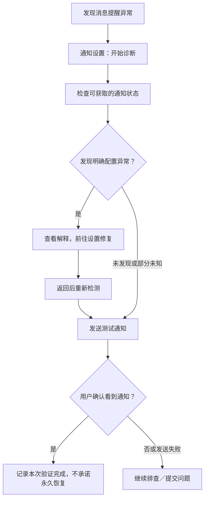

# Mini PRD：通知状态诊断 / Notification Health Check

范围：飞书/Lark 移动端问题的概念设计，非已实现功能或上线承诺。原型采用 Android 场景；不宣称飞书现有架构已支持下述检测能力。

## 1. 需求背景

**用户反馈事实**：在当前飞书/Lark 的 31 条问题反馈中，通知模块为 6/31（19.35%）。Top 1「消息通知未送达或通知栏显示异常」（`ISS-3955d4f6ed9d`）占其中 5 条，全部 evidence_ids 为 **L002、L003、L010、L016、L038**。第 6 条属于其他通知问题，不计入本 Issue。

**该结论仅基于当前采集样本，不代表整体用户规模或市场表现。** 评论条数不是独立用户数或故障发生率。

E2 沿用的 AI 标签：模块「通知」，类型分布 `Bug: 5`，严重程度 `高: 4 / 中: 1`；产品优先级「高」。这些是已有预测与编辑判断，不是重新人工判级。E2 快审不是产品负责人签核。

证据来源（只读）：[完整 E2 产品卡与原文](../analysis/results/e2_product_insights/review_audit.json)、[Top 5](../analysis/results/e2_product_insights/top_issues.csv)、[模块统计](../analysis/results/e2_product_insights/product_comparison.csv)、[原文映射](../analysis/results/e2_product_insights/evidence.csv)、[正式洞察](../analysis/results/e2_product_insights/product_insights.md)。以 JSON 的 Top 1 卡片为完整证据依据。

## 2. 问题定义

**用户反馈事实**：用户等待消息、后台使用或查看通知栏时，未可靠获得消息提醒。L002 表示需要进入应用主界面才能触发更新；L003 报告安卓推送收不到；L010 报告通知不来或很快消失，并明确影响工作；L016 报告没有消息通知；L038 报告更新后通知栏部分通知缺失，且省电已关闭。

E2 Problem Summary：五条评论反映通知未到达、很快消失或未显示在通知栏，部分涉及后台设置与手动进入应用。后果是难以及时获知工作消息；没有证据量化漏处理任务或经济损失。现有证据未明确覆盖全部锁屏场景，不将锁屏故障写为已证实现状。

E2 Priority Reason：重复证据数最高，高严重程度 4/5，涉及核心即时通信任务。不同症状不等于同一根因。E2 竞品背景中，企业微信 W008、W021 也报告通知收不到；不能用 5 对 2 推断真实送达率或竞品优劣。

## 3. 用户证据

以下为 E2 已保存的三条代表评论，逐字引用，不以翻译替换原文：

**L002**

> 小米手机上经常收不到消息通知，即使开了保活的通知栏，给了后台无限制电源策略，给了自启动权限，在后台任务管理界面上加锁防止被清理，但还是没有消息通知，明明app还在运行，非得时不时的进去主界面看一下才会触发消息更新。实在不行就接上小米推送或者其他国内稳定一定的推送服务吧，明明是一个即时通讯软件，搞得得手动去查看有没有消息…

**L003**

> 安卓手机收不到消息推送，这是即时通讯APP最基础的能力。我小米和朋友华为都是这样，基础能力不做好整天做些乱七八糟的功能，舍本逐末。市面上哪个流行的通讯APP不正常推的？

**L010**

> もう、半年以上使ってますが、通知がきません。もしくはすぐ消えます。スマホの設定、アプリの設定色々いじってもダメです。仕事で使っているので非常に困っています。

全部证据仍为 L002、L003、L010、L016、L038；后两条完整原文可按 ID 在上述 JSON / evidence.csv 回溯。

## 4. 设计目标（产品设计推断）

1. 让用户看懂已检查什么、哪些状态未知，以及下一步可做什么，而非承诺自动定位所有根因。
2. 降低配置类问题的排查成本；已检查正常时，不反复要求修改同一权限。
3. 提供「检查 → 引导 → 测试 → 确认或提交问题」的闭环。

## 5. 非目标

不重构整个消息系统、全部通知策略管理或服务端推送基础设施；不做智能通知排序；不承诺覆盖所有平台、所有设备或所有通知故障。此设计不将“诊断工具”当作底层可靠性修复的替代品。

## 6. 产品方案（均为方案设想，待技术评估）

轻量功能：**通知状态诊断 / Notification Health Check**，入口位于移动端通知设置。

| 能力 | 交互与判定边界 |
| --- | --- |
| 状态入口 | 初始为「未检测」。检查后区分「本地检查未发现异常」「存在已确认配置异常」「需检查／部分状态未知」。不得把未知写成异常，把本地正常写成通知链路正常。显示检测时间。 |
| 本地检查 | 设想检查 App 内消息通知、系统通知权限、后台运行限制及可获取的设备状态。只有可读取且可解释的结果才判定开／关；无法读取则显示「无法自动确认」，提供手动核对。各项 API 与厂商适配均待客户端确认。 |
| 修复引导 | 只有读到系统通知关闭等明确结果，才显示相应原因及「前往系统设置」。后台限制仅可提示“可能影响提醒”，不据此断言根因。跳转不可用时显示手动路径；返回后重新检测。 |
| 测试通知 | 用户主动点击后尝试单条测试；是否可复用真实推送链路、后台测试方式与观测能力，需客户端／服务端确认。客户端保持前台弹出提示不算后台推送验证通过。 |
| 确认与兜底 | 区分「请求未发送」「发送请求已受理」「等待用户确认」「用户确认看到通知」。只有具备可靠展示回执时，才可显示“设备展示已确认”；否则使用“你是否看到了测试通知？”。未恢复可提交问题，附用户确认过的检测摘要与设备信息，不自动采集聊天内容。 |

该方案细化 E2 的“分段排查送达链路、提供可理解诊断与状态提示”，不预设服务端、权限或设备厂商中的任何一方必然为根因。三个页面及状态变体见 [Figma 规格](top1_notification_figma_spec.md)。

## 7. 核心用户流程

## 8. 异常与边界

- **本地检查均正常但仍收不到**：提示“未发现可确认的本地配置异常，仍可能存在其他问题”，允许测试及提交，不重复强推权限调整（L002、L038 是重要反例）。
- **用户拒绝修改权限或中途离开**：保留未解决状态，可返回或继续提交；不标记“修复成功”。
- **测试发送失败／请求已受理但未看到**：分别显示发送失败、展示未确认；允许用户主动重试或提交，不自动无限发送。
- **不同 OS／厂商能力不同或状态读不到**：标注未知／需手动检查，跳转失败给手动路径，不将不可读判为关闭；首版只验证 Android 概念范围。
- **测试看到但日常仍异常**：只记录“本次测试用户确认看到”，允许继续反馈并说明后台条件可能不同，不宣告故障已修复。

## 9. 验证指标（未来定义，无当前值或目标值）

| 层级 | 指标 | 口径 |
| --- | --- | --- |
| Primary | 通知诊断完成率 | 展示完整检查结果的诊断会话数 / 主动开始诊断的会话数；部分结果未知仍可完成，但单列未知比例。 |
| Primary | 配置异常解除率（修复成功代理） | 复检确认原已识别配置异常解除的会话数 / 识别到可处理配置异常的会话数；未返回不算已解除。不等于通知故障修复率。 |
| Primary | 测试通知确认率 | 用户确认看到测试通知的有效测试次数 / 用户发起的有效测试次数；未确认不计成功，发送失败单列。不能称为真实送达率。 |
| Secondary | 通知相关负反馈占比 | 通知相关负反馈条数 / 同期问题反馈总条数；保持采集来源和分类口径可比。 |
| Secondary | 重复提交率 | 可合规关联的同一问题重复提交数 / 有效通知问题提交数；关联方法及观察窗口上线前确定。 |
| Secondary | 系统设置返回完成率 | 从设置返回并完成复检的诊断会话数 / 点击前往系统设置的会话数。 |

埋点及去重窗口需上线前确定，尽量只记录状态与流程事件、不记录消息正文。E2 原有的分设备／后台状态送达率与端到端延迟分位数，只有补齐可信链路观测后才能用于效果验证；不可用“请求受理”或用户确认代理冒充真实链路指标。

## 10. 风险与待验证问题

- 当前仅 5 条证据，缺少均衡设备、OS、时间与更多真实使用验证；不是完整需求调研。
- 同样“收不到通知”可能来自不同根因；通知消失／展示缺失未必能靠权限修复。
- 客户端能否读取具体系统权限、后台状态及可靠跳转，需技术评估；不同 OS 与厂商机制不同。
- 诊断工具可能仅覆盖配置类问题，不能解决服务端推送故障；底层链路修复仍需独立定位。
- 测试链路、展示回执和真实后台场景的等价性待验证；提交诊断信息需隐私评审与用户确认。

先复现已有证据，再评估原型可理解性和技术可观测范围；未确认前不承诺排期或业务收益。

## 11. Why this requirement?

在54个候选Issue和Top 5中，我选择通知问题继续设计，因为它有5条证据，是当前多成员Issue中重复最多的一项，并涉及即时通信产品的核心消息获取任务。在当前飞书问题样本中，通知占6/31，适合将评论证据进一步转化为具体交互。但这些证据只确认症状，没有证明共同根因，因此我选择边界较小的诊断、修复引导与测试闭环，而非承诺重构推送系统。后续仍需更多真实用户、设备复现及客户端和服务端技术验证，再判断是否值得实现及能覆盖哪些问题。
